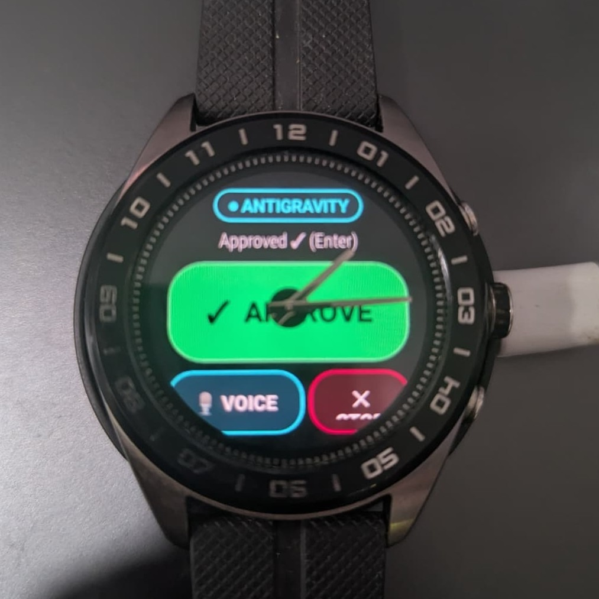

# ⌚ RakWatch — Ultra-Light Wear OS Remote for Claude Code & Antigravity

<p align="center">
  
</p>

Built specifically for legacy **Snapdragon Wear 2100 / 768 MB RAM** watches like the **LG Watch W7 (`narwhal`)**:
- **Zero bloated UI frameworks** — pure native Kotlin Android SDK (**26 KB APK**, < 15 MB RAM, instant startup!)
- **Giant `✓ APPROVE` button** + `✕ STOP` + hardware side-button shortcuts (`STEM_1` = Approve, `STEM_2` = Voice)
- **🎙️ Native Wear OS Voice Input** → sends spoken prompts over LAN directly to **Antigravity** or **Claude Code**
- **Local PC Bridge (`bridge/rakwatch_bridge.py`)** + **Claude Code `PreToolUse` Hook (`bridge/claude_hook.py`)** with wrist vibration alerts

## 📦 Quick Install (ADB over Wi-Fi)

```bash
adb connect <WATCH_IP>:5555
adb install -r app-release.apk
```

Start the local PC bridge (`http://0.0.0.0:8765`):

```bash
python bridge/rakwatch_bridge.py
```
